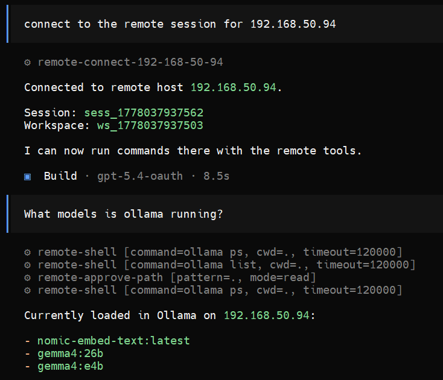

# opencode-remote-ssh



Provider-based remote workspace plugin and Go stub for using OpenCode against Linux hosts that cannot run OpenCode directly.

## Overview

`opencode-remote-ssh` lets OpenCode work against remote Linux machines over SSH.
The system has two parts:

1. A local OpenCode plugin that resolves configured hosts, manages SSH bootstrap, and exposes the remote workspace tools.
2. A small Go stub installed on the remote host that serves an OpenCode-compatible API over an SSH tunnel.

## Loading the Plugin

OpenCode 2.x registers plugins through the `"plugins"` array in `opencode.json`, using object entries:

```json
{
  "plugins": [
    {
      "package": "<name-or-path>",
      "options": { ... }
    }
  ]
}
```

`package` may be an npm package name or a local filesystem path. The `opencode-remote-provider` npm package has not been published, so loading the plugin from a local checkout of this repository is the only supported way at this time.

The helper CLI `scripts/opencode-remote-cli.sh` manages the plugin entry in the `plugins` array — both package-name entries and local-path entries.

## Features

- Provider-based host management
- Explicit host selection by configured `name`, real `ssh.host`, or friendly `aliases`
- SSH bootstrap for the remote stub
- Hash-checked stub installation that reuses the installed binary when it already matches
- Plugin-managed SSH tunneling with tracked local tunnel teardown
- Collision-aware local tunnel port selection
- Persisted binding recovery with stale-state cleanup after restarts
- Permission-first path access
- `once` and persistent `always` approvals per workspace
- Self-contained remote stub binary
- Workspace session restore support
- Shell and command execution endpoints on the remote stub
- User-facing `remote-switch`, `remote-status`, `remote-disconnect`, and `remote-doctor` tools
- Lower-level `remote-workspace-create`, `remote-workspace-list`, and `remote-workspace-remove` tools
- Configurable local `stubBinaryPath` override when auto-discovery is not suitable
- Live remote lifecycle harness for validating a configured host before relying on interactive use
- Stub test harness covering auth, permission flow, session restore, and execution behavior

## Current Limitations

- The plugin persists local binding state and can recover stale tunnels after restart, but remote token rotation can still invalidate old bindings; reconnecting creates a fresh binding when recovery fails.
- Tunnel cleanup intentionally prefers safety over aggressive process matching; recovered bindings without a trusted tracked PID may require manual cleanup if a reachable orphan tunnel already exists.
- The live remote lifecycle harness requires a real configured host and SSH access; it is not run automatically by the unit test suite.

## Requirements

- Local: OpenCode, Node.js for the plugin, Go 1.21+ to build the stub
- Remote: Linux, SSH access, POSIX shell

If the plugin cannot find the stub binary automatically, set `stubBinaryPath` in the plugin config to the built `opencode-remote-stub` binary.

## Quick Start

### 1. Configure the Plugin

The plugin is loaded from a local checkout of this repository:

```json
{
  "plugins": [
    {
      "package": "/absolute/path/to/opencode-remote-ssh/plugin",
      "options": {
        "providers": {
          "default": {
            "strategy": "first_available",
            "hosts": [
              {
                "name": "prod-web-1",
                "aliases": ["web-primary", "prod-app"],
                "ssh": {
                  "host": "203.0.113.10",
                  "user": "ops",
                  "port": 22,
                  "identityFile": "~/.ssh/id_ed25519"
                },
                "labels": ["linux", "production"]
              }
            ]
          }
        }
      }
    }
  ]
}
```

### 2. Add Hosts with the CLI

The CLI manages the remote plugin entry in the `plugins` array of `~/.config/opencode/opencode.json`.

```bash
./scripts/opencode-remote-cli.sh add default prod-web-1 ops 22 ~/.ssh/id_ed25519
./scripts/opencode-remote-cli.sh list
```

### 3. Bootstrap the Remote Stub

Use the setup script to preinstall and start the remote stub on the host:

```bash
./scripts/setup-host.sh 203.0.113.10 ops 22 ~/.ssh/id_ed25519
```

What this does:

1. Verifies SSH connectivity
2. Creates remote directories under `~/.opencode-remote/`
3. Uploads the stub binary
4. Writes a new auth token
5. Starts the stub on the remote host

What it does **not** do by itself:

1. It does not permanently attach OpenCode to the remote host.
2. The runtime connection is established later by the plugin when a workspace is created.

This step is useful for manual preflight work. The normal plugin path also bootstraps or updates the stub when `remote-switch` or workspace creation runs.

### 4. Connect to a Remote Host

The plugin exposes a convenience tool for the common first-launch path:

```text
Use the remote-switch tool with provider default and host prod-web-1.
```

`remote-switch` resolves the configured host `name`, real `ssh.host`, or alias; ensures the stub is installed and running; creates or recovers the SSH tunnel; verifies remote health; creates a remote workspace/session; and persists the local binding for later recovery.

You can check or recover current bindings with:

```text
Use the remote-status tool.
```

You can run a preflight without keeping a new test workspace around with:

```text
Use the remote-doctor tool with provider default and host prod-web-1.
```

You can disconnect with:

```text
Use the remote-disconnect tool.
```

### 5. Create a Remote Workspace Directly

Prefer `remote-switch` when you want the active session to move to the remote host. To create a workspace binding without switching the session, use the lower-level tool:

```text
Use the remote-workspace-create tool with provider default and host prod-web-1.
```

The plugin will:

1. Resolve the configured host by `name`, `ssh.host`, or alias
2. Ensure the remote stub is installed and running
3. Establish a local SSH tunnel
4. Verify remote health
5. Persist the local binding for later recovery

Existing bindings can be inspected with `remote-workspace-list` and removed with `remote-workspace-remove`.

## CLI Commands

```bash
./scripts/opencode-remote-cli.sh init
./scripts/opencode-remote-cli.sh add <provider> <host> <user> [port] [identity-file]
./scripts/opencode-remote-cli.sh remove <provider> <host>
./scripts/opencode-remote-cli.sh list
./scripts/opencode-remote-cli.sh setup <host> <user> [port] [identity-file]
```

Notes:

1. The CLI creates timestamped backups of `~/.config/opencode/opencode.json` before modifying it.
2. The CLI supports both bare package-name entries and local-path entries in the `plugins` array; bare string entries are promoted to object form when options are added.
3. The CLI rejects legacy OpenCode V1 `plugin` entries and prints the V2 shape to use instead.

## Local Checkouts

Because the npm package has not been published, loading from a checkout is the normal setup. The CLI in this repository manages that entry directly:

1. `init` appends the entry when it is missing, pointing at the `plugin/` directory of the checkout the CLI was invoked from.
2. `add`, `remove`, and `list` update and read the entry in place.
3. Entries that are bare strings (package-name style) are promoted to object form automatically when options are added.

## Host Aliases

Each host may now define optional `aliases`, and workspace creation can target either the canonical `name` or any configured alias. The plugin still resolves the real network destination from `ssh.host` at runtime.

Example:

```json
{
  "providers": {
    "default": {
      "hosts": [
        {
          "name": "prod-web-1",
          "aliases": ["web-primary", "prod-app"],
          "ssh": {
            "host": "203.0.113.10",
            "user": "ops",
            "port": 22
          },
          "labels": ["linux", "remote"]
        }
      ]
    }
  }
}
```

Any of these targets resolves to the same configured host, whether passed to `remote-switch`, `remote-workspace-create`, or `remote-doctor`:

- `prod-web-1` (canonical `name`)
- `web-primary` (alias)
- `203.0.113.10` (real `ssh.host`)

## Permission Model

Path access is denied by default.

When a shell or command operation attempts to access an unapproved path:

1. The stub creates a permission request.
2. The request must be approved explicitly.
3. `once` approvals allow exactly one matching operation.
4. `always` approvals persist for that workspace.

The plugin does not auto-approve these permissions.

## Remote Install Layout

On the remote host, files are installed under `~/.opencode-remote/`:

```text
~/.opencode-remote/
├── bin/
│   └── opencode-remote-stub
├── run/
│   ├── stub.token
│   └── stub.pid
├── log/
│   └── stub.log
└── state/
    ├── workspaces/
    ├── sessions/
    └── approvals/
```

## Manual Verification

Run the full plugin/stub lifecycle harness from the plugin directory after building the stub and configuring at least one host:

```bash
cd plugin
npm run verify:remote -- --provider default --host prod-web-1
```

The harness uses the same provider registry and SSH manager as the plugin. It resolves the host by `name`, `ssh.host`, or alias; bootstraps or updates the stub; creates a tunnel; health-checks through the forwarded URL; creates a workspace/session; verifies the permission flow with a shell command; and cleans up the test workspace/session/tunnel.

If you want to verify the stub manually after setup:

```bash
ssh -N -L 39300:127.0.0.1:39217 user@host
TOKEN=$(ssh user@host 'cat ~/.opencode-remote/run/stub.token')
curl -H "Authorization: Bearer $TOKEN" http://127.0.0.1:39300/global/health
```

## Operating Notes

1. Older hosts such as CentOS/RHEL 7 era systems may require a statically built stub binary.
2. The current build/test flow for this repository uses `CGO_ENABLED=0` when targeting those older hosts.
3. The stub is launched in its own session with pure POSIX `setsid`, so sshd session teardown cannot kill it when the bootstrap SSH connection closes. The previous `python2 || python` Python launcher was removed because it silently no-oped on hosts where only `python3` is installed.
4. Plugin bootstrap compares the local and remote stub hashes before upload, so a healthy matching binary is reused instead of overwritten.
5. Persisted bindings are recovered through the forwarded health endpoint; bindings that cannot be resolved or reached are removed from local state so they do not block a future connection.
6. Password-only SSH hosts are supported for bootstrap:
   - if `sshpass` is installed locally, the script can install the generated key automatically
   - otherwise, the script prints exact manual `authorized_keys` setup steps

## Development

Build the plugin:

```bash
cd plugin
npm install
npm run build
```

Build the stub:

```bash
cd stub
CGO_ENABLED=0 go build -o bin/opencode-remote-stub ./cmd
```
